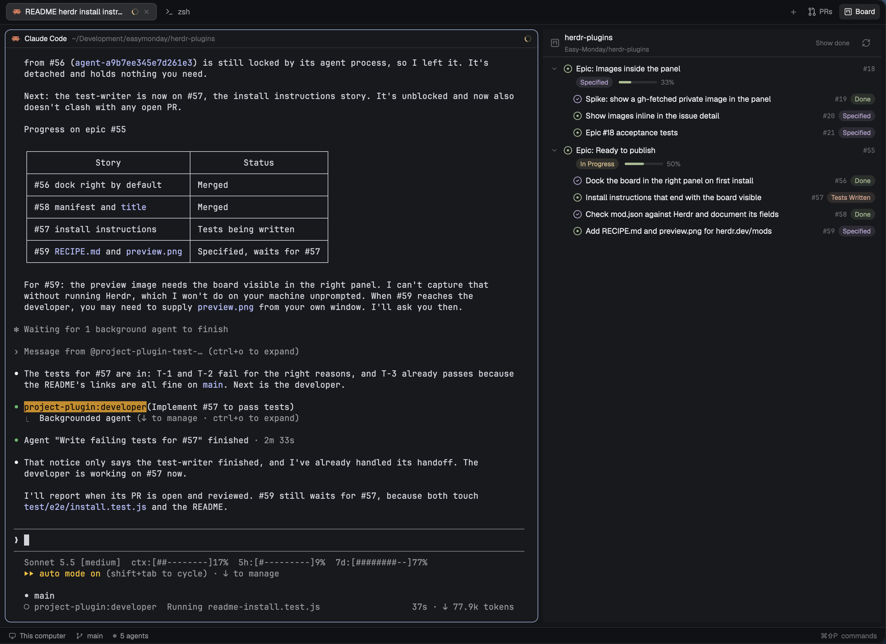

# Herdr Project Board

A read-only side panel for [Herdr Desktop](https://github.com/herdrdev/herdr-app) that shows the GitHub project board linked to the repo of your active tab. Follow epics, stories and their sub-issues while agents work, without keeping a browser open beside Herdr. It works with GitHub through the `gh` CLI.



An opened issue looks like [docs/preview-detail.png](docs/preview-detail.png). [RECIPE.md](RECIPE.md) describes the mod for herdr.dev/mods.

> **Status:** `v0.1.0`, the first release.

## What it shows

- **The right board, automatically:** the panel follows the focused terminal's folder, finds its GitHub repo (`upstream`, then the branch's tracking remote, then `origin`) and shows the one Projects (v2) board linked to it.
- **Board list:** top-level items in the board's order with their state, `#number`, Status pill and sub-issue progress.
- **Sub-issues** nest under their parent, at any depth.
- **Done hidden by default**, with a **Show done** toggle.
- **Issue detail:** click a row for its body, sub-issues (with Back to the parent), and one timeline of comments and this board's Status changes, with agent handoff comments highlighted.
- **Images as links:** images in issues and comments show as **Open image** links that open in your browser, since private repos' images need your GitHub login.
- **Keeps current:** refreshes every 60 seconds (the `refreshSeconds` block prop, see [Place the panel](#place-the-panel)) and on the refresh button, keeping your place.

It never changes anything on GitHub or in git: GraphQL queries only, and read-only git commands.

## Requirements

- Herdr Desktop.
- The **GitHub CLI** on this computer, logged in with the `project` scope: `gh auth login -s project`, or `gh auth refresh -s project` if you're already logged in. Every GitHub call goes through `gh`; there's no token setting.
- Git on the machines your spaces run on. For a space on another machine, git runs there and `gh` runs on this computer.

If `gh` is missing, logged out or lacks the scope, the panel says so and shows what to run.

## Install

Copy this prompt into your Herdr agent:

> Read ~/.config/herdr-app/AGENTS.md, then add this mod: https://github.com/Easy-Monday/herdr-plugins (install `mod/` as `~/.config/herdr-app/mods/project-board`), and add it as a panel in the layout's right panel next to Files and Changes, with a "Board" button in the tab bar; if Herdr also docked the board as its own column, remove that column

Herdr has no install command: installing a mod means copying its folder into `~/.config/herdr-app/mods/`, which `scripts/install.sh` does. A new install may need a Herdr restart before the board appears.

<details>
<summary>Install by hand</summary>

```sh
git clone https://github.com/Easy-Monday/herdr-plugins.git
cd herdr-plugins
scripts/install.sh            # copies mod/ to ~/.config/herdr-app/mods/project-board
herdr-app check ~/.config/herdr-app/mods/project-board
```

`scripts/install.sh` needs only standard Unix tools (`sh`, `tar`, `find`, `cp`). It doesn't edit layouts or keys. Run it again after pulling a new version. `HERDR_APP_HOME` installs into another Herdr home.

A by-hand install docks the board as its own column on the right (`place: right`, 368px wide). To move it into the right panel's stack next to Files and Changes, see [Place the panel](#place-the-panel).

</details>

### Place the panel

By default the board docks as its own column on the right, 368px wide: the first time Herdr sees the `project-board` folder, it docks the board into the layout you are looking at (`mod.json` has `"place": "right"` and `"size": 368`). After that your layouts decide, and running the install again doesn't dock it a second time.

To move or remove it, edit a layout you own (clone one first: `herdr-app do layout.clone '{"name":"main","as":"my-layout"}'`): delete the block whose `content.mod` is `project-board` to remove it, or put that block somewhere else to move it. The usual spot is the right panel's `panel-body` stack, next to `files` and `changes`:

```json
{ "id": "project-board", "type": "block", "content": { "mod": "project-board", "props": { "refreshSeconds": 120 } } }
```

`props` is optional. `refreshSeconds` sets how often the board reloads from GitHub: the default is 60 seconds, and values below 60 count as 60. Leave `props` out to keep the default.

To open it from the tab bar, add a button that selects that block, in a tab bar you own: clone it with `herdr-app do mod.clone '{"name":"tabs","as":"my-tabs"}'` and point your layout's tab bar block at `my-tabs`. In that clone, the button's click runs:

```js
run("layout.select", { stack: "panel-body", child: "project-board" });
run("layout.show", { id: "panel" });
```

With [Better Tabs](https://github.com/munza/herdr-mods/tree/main/better-tabs), a button entry does the same (a `buttons` list replaces its default buttons, so list Files and Changes too if you want them):

```json
{
  "id": "board",
  "label": "Board",
  "action": { "type": "panel", "container": "panel", "stack": "panel-body", "target": "project-board" }
}
```

To try it without changing a layout, open it as a tab: `herdr-app do tab.new '{"mod":"project-board"}'`.

### `mod.json`

`mod/mod.json` sets three keys:

- `title`: `"Project Board"` is the mod's name as Herdr shows it. Herdr's own shipped mods set it, but Herdr's `AGENTS.md` doesn't document it.
- `place`: `"right"` docks the board as its own column on the right. Herdr reads it only the first time it sees the folder.
- `size`: `368` makes it 368px wide, also read only the first time.

For the other keys Herdr documents, see Herdr's `AGENTS.md` ("Mods"); this mod uses none of them. There is no `version` key: the version lives only in `package.json`.

## Development

The mod is gpui-kit JavaScript run by Herdr, not Node; Node 26 (`.nvmrc`) runs the tests and scripts. Commands, layout and test approach are in [CLAUDE.md](CLAUDE.md). In short:

```sh
npm ci
npm test              # unit and e2e (Herdr runtime stubbed)
npm run lint
npm run check         # herdr-app check mod (needs Herdr)
npm run preview       # install this checkout as project-board-preview
```

Requirements are in [docs/brd.md](docs/brd.md); work is tracked on the GitHub project board linked to this repo.

## License

[Apache License 2.0](LICENSE). Repository-detection and UI code is adapted from [Branch PR](https://github.com/munza/herdr-mods/tree/main/branch-pr) (Apache-2.0); see [NOTICE](NOTICE).
