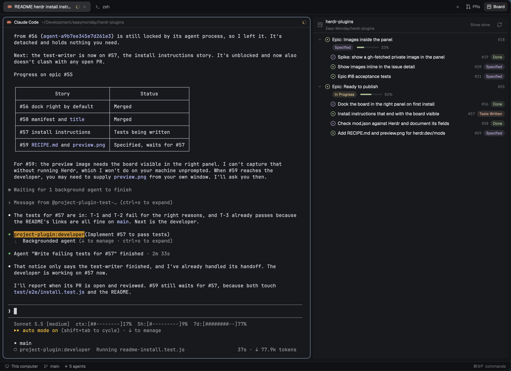

# Project Board

A read-only panel, docked on the right, that shows the GitHub Projects (v2) board linked to the repo of the terminal you are working in: the board's epics and stories in board order, each with its Status pill and sub-issue progress, sub-issues nested under their parent, and a click-through detail of any issue with its body, sub-issues, comments and Status changes. It follows you as you switch tabs or `cd`, so the board beside your agents is always the one for the repo in front of you.

## What you see

Opened issue: [docs/preview-detail.png](docs/preview-detail.png).

All colours come from `theme()`; text is Herdr's UI font, 13px for body text, 12px small, 11px captions. Issue numbers and commands use the terminal font (`settings().font_family`).

- **Header**, 46px tall, 12px side padding, a 1px `border` line under it: a 16px board icon in `dim`, then the board's title (medium weight) over `owner/repo` (11px, `dim`), both truncated. On the right, a **Show done** toggle (22px, 11px text, a check icon and `selected` background when on) and a 26px refresh icon button. Before a board loads, the title is "Project Board" and the subtitle is the repo or folder.
- **Board list**, scrolling, 6px side padding. Each top-level item is two lines:
  - an 18px chevron slot (12px chevron, empty when the item has no sub-issues, so titles line up), a 15px state icon, the title (truncated) and `#number` (11px, `dim`) at the right;
  - indented 45px: the Status pill and, when the item has sub-issues, a 64×4px progress bar in `ansi2` on `raised` with the percent closed beside it.
- **Sub-issue rows**, 28px tall, indented 20px per level: chevron, state icon, title, `#number`, Status pill last.
- **State icons** as GitHub draws them: open issue `ansi2`, closed `ansi5`, closed as not planned `dim`; pull request open `ansi2`, merged `ansi5`, closed `ansi1`, draft `dim`; draft issue `dim`.
- **Status pill**: 18px tall, fully rounded, 7px padding, 11px text in the option's colour on that colour at low alpha (`24` hex). GitHub's option colours map to theme colours: gray `muted`, blue `ansi4`, green `ansi2`, yellow `ansi3`, orange halfway between `ansi1` and `ansi3`, red `ansi1`, pink `ansi13`, purple `ansi5`.
- **Issue detail** (replaces the list): a header row with a back chevron, state icon, the issue type as an outlined tag (Epic, Task, Bug ...), `#number`, Status pill, then refresh and open-on-GitHub icons; the title wraps under it. Below, scrolling with 14px padding and 18px between sections: the body as markdown, **Sub-issues** with their count and 28px rows, then **Activity** with its count: comments (author, relative time like "2h ago", the markdown body) and Status changes as one `dim` 11px line with a 12px board icon, "In Progress → In Review · 25m ago", oldest first. A handoff comment gets a 2px `accent` bar on its left and a small "Handoff" tag.
- **Notices** fill the panel when there is no board to show: a 24px icon, a title, a short explanation, then a command in a code box and/or buttons (30px, the primary one `solid`). They cover: not a git repo, no GitHub remote, no linked board, more than one linked board (listed by name), git failing, `gh` missing, logged out, missing the `project` scope, any other API error, an empty board, and a board where everything is done.

## How it behaves

- **Follows focus.** Every second it reads the active space and the focused terminal's folder. A new folder (or machine) re-detects the repo and loads its board. A tab without a terminal keeps the space's last folder.
- **Finds the repo** from git remotes: `upstream`, then the current branch's tracking remote, then `origin`, then any GitHub remote. Only github.com remotes count (SSH host aliases like `github-work` too).
- **Finds the board**: the repo's linked Projects (v2) boards, closed ones ignored. Exactly one open board is shown; none or several show a notice.
- **Refreshes** every 60 seconds (the `refreshSeconds` block prop; values below 60 count as 60) and on the refresh button. A reload keeps the current screen while the refresh icon spins, and keeps expanded rows and scroll position. Each repo remembers its own expanded rows, scroll and last board, so switching back is instant. An open issue reloads on the same timer.
- **Clicks**: the chevron expands or collapses a row's sub-issues (collapsed by default) without opening it. A row opens its detail; a sub-issue in a detail opens its own detail, and back goes one step up (sub-issue, parent, list). A pull request or draft issue opens a notice with an "Open on GitHub" button instead (a draft issue opens the board's item pane). The header's external-link icon and links in markdown open the browser.
- **Show done** shows top-level items whose Status is "Done"; off by default. Its state is remembered across restarts (`localStorage`, key `show-done`). Children of an expanded row always show, done or not.
- **Images** in issue bodies and comments become "Open image: name" links, because private repos' images need a GitHub login the panel doesn't have.
- **Handoffs**: a comment whose first line starts with `Tests written at ` or `Prototype handoff at ` is marked as a handoff.
- Rows and buttons highlight with `hover` on mouse-over. There are no keyboard shortcuts.
- A failed reload keeps what was shown: a board stays, an open issue stays with "Couldn't refresh: ..." and Try again above it.

## Built from

- One mod folder, `mod/`, installed as `mods/project-board` (`scripts/install.sh` copies it and writes the installed folder name into `src/name.js`, which icon paths use). No layout, no `keys.json`.
- `mod.json`: `"place": "right"` and `"size": 368` dock it in the right panel at 368px the first time Herdr sees the folder; `"title": "Project Board"` is its name in Herdr.
- `main.js` exports the View; `ui.js` holds the small components (Panel, Header, IconButton, TextButton, StatusPill, Progress, Chevron, Notice, Button, Markdown, TypeTag, HandoffTag); `src/` holds pure logic (repo detection, board tree, issue parsing, activity, image links, error kinds) and the two modules that run programs.
- Block props: `refreshSeconds` (optional).
- `herdr`: `theme`, `spaces`, `panes`, `props`, `settings`, `checking`, `exec`. gpui-kit `View`, `div`, `svg`; gpui-base `v_flex`, `h_flex`, `ScrollHandle`, `TextView.markdown`. `cx.timer.every`, `cx.spawn`, `cx.notify`, `cx.open_url`.
- Programs it runs, both through `exec`:
  - `git`, read-only (`remote`, `remote get-url`, `symbolic-ref`, `config --get`), in the terminal's folder on the space's machine.
  - `gh api graphql`, queries only (linked boards, board items 100 per page, one issue with its comments and Status changes), on this computer. `src/gh.js` is the only place that calls it.
- It reaches the network only through `gh`, to GitHub's GraphQL API. It reads no files outside its own folder.
- Shipped mods it uses: none; it sits in the right panel's stack beside `files` and `changes`.
- Art: SVG icons in `mod/icons/` from Lucide (ISC license, in that folder).

## Watch out

- Herdr docks it only the first time it sees the `project-board` folder. After that the layouts decide; reinstalling doesn't dock it again. To move or remove it, edit a layout you own.
- It needs the GitHub CLI on this computer, logged in with the `project` scope (`gh auth login -s project`, or `gh auth refresh -s project`). There is no token setting. Without it the panel shows what to run.
- It is read-only: GraphQL queries and read-only git commands, never a mutation. It can't change Status, comment or edit.
- What it assumes: a github.com repo (not GitHub Enterprise), exactly one open Projects (v2) board linked to the repo, a single-select field named `Status`, `git` on the machine the space runs on.
- Limits: per issue, the latest 100 comments and 100 Status changes; 100 sub-issues per item; refresh never faster than 60 seconds. Images are links, not shown inline.
- Mod rules that a fresh build gets wrong: no `setTimeout` (use `cx.timer`), return after `if (checking()) return;` before any `exec` or timer in `init`, and create `ScrollHandle`s outside `render`.

## Done when

- `herdr-app check` passes on the installed folder.
- In a repo with one linked board, the panel shows its title, `owner/repo` and the board's items with Status pills; `cd` into another repo switches the board within a second or two.
- Clicking an issue shows its body, sub-issues and activity; back returns to the list.
- With `gh` logged out, the panel shows the "gh isn't logged in" notice with `gh auth login -s project`.
